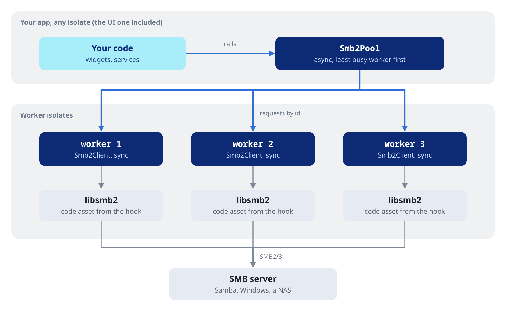

# dart_smb2

#### SMB2/3 client for Dart and Flutter.

[](https://pub.dev/packages/dart_smb2)
[](https://github.com/ales-drnz/libsmb2-scripts)
[](LICENSE)
[](https://github.com/ales-drnz/dart_smb2)
[](https://discord.gg/g2Qf4Mq9MP)
[](https://www.patreon.com/cw/ales_drnz)
[](https://www.buymeacoffee.com/ales.drnz)

<table>
<tr>
<td valign="middle" width="90"></td>
<td valign="middle"><code>dart_smb2</code> is a Dart client for SMB2 and SMB3 file shares, built on libsmb2. It lists, reads, streams, downloads and writes files on Samba, Windows and NAS shares from worker isolates that reconnect on their own.</td>
</tr>
</table>

---

## Installation

Add `dart_smb2` to your `pubspec.yaml`:

```yaml
dependencies:
  dart_smb2: ^0.2.4
```

## Platform requirements

| Platform  | Minimum | Architecture | Size | Device | Emulator |
| :--- | :--- | :--- | :---: | :---: | :---:
| Android | 7.0 (SDK 24) | arm64-v8a, armeabi-v7a, x86_64 | 246, 233, 253 KB | Yes | Yes |
| iOS | 13.0 | arm64, x86_64 | 271, 235 KB | Yes | Yes |
| macOS | 10.15 | arm64, x86_64 | 257, 239 KB | Yes | - |
| Windows | 10 | arm64, x86_64 | 238, 256 KB | Yes | - |
| Linux | glibc 2.31 (Ubuntu 20.04, Debian 11) | aarch64, x86_64 | 259, 268 KB | Yes | - |

The package needs Dart 3.10, and Flutter 3.47 in a Flutter app. It is a plain Dart package: command-line tools and servers use it as well.

---

## Features

<table>
<tr>
<td valign="middle" width="48"></td>
<td valign="middle" width="45%"><b>Pure Dart</b><br>no Flutter plugin: a build hook bundles libsmb2 for Android, iOS, Linux, macOS and Windows, checked against pinned SHA-256s.</td>
<td valign="middle" width="48"></td>
<td valign="middle" width="45%"><b>Worker isolates</b><br><a href="https://pub.dev/documentation/dart_smb2/latest/topics/Connection-topic.html"><code>Smb2Pool</code></a> runs one connection per isolate and sends each call to the least busy one; the UI isolate never waits on the network.</td>
</tr>
<tr>
<td valign="middle"></td>
<td valign="middle"><b>Reconnects</b><br>a dropped connection is <a href="https://pub.dev/documentation/dart_smb2/latest/topics/Errors%20and%20cancellation-topic.html">reconnected once</a> for every caller, the call repeated when that is safe, and open files reopened.</td>
<td valign="middle"></td>
<td valign="middle"><b>Streaming and downloads</b><br><a href="https://pub.dev/documentation/dart_smb2/latest/topics/Reading%20and%20writing-topic.html"><code>streamFile()</code></a> reads one chunk ahead; <a href="https://pub.dev/documentation/dart_smb2/latest/topics/Reading%20and%20writing-topic.html"><code>downloadToFile()</code></a> writes at the disk's pace and renames into place only when complete.</td>
</tr>
<tr>
<td valign="middle"></td>
<td valign="middle"><b>Cancellation</b><br>every call on a connected pool but the closing ones takes an <a href="https://pub.dev/documentation/dart_smb2/latest/topics/Errors%20and%20cancellation-topic.html"><code>Smb2CancelToken</code></a>, the same as dart_plex's and dart_jellyfin's.</td>
<td valign="middle"></td>
<td valign="middle"><b>Typed errors</b><br>every failure is a <a href="https://pub.dev/documentation/dart_smb2/latest/topics/Errors%20and%20cancellation-topic.html"><code>Smb2Exception</code></a> classified from the server's NT status: auth, not found, network, transient, cancelled.</td>
</tr>
<tr>
<td valign="middle"></td>
<td valign="middle"><b>No extra copies</b><br>reads land in native buffers that reach your isolate without a copy.</td>
<td valign="middle"></td>
<td valign="middle"><b>SMB3 security</b><br>NTLM sign-in, <a href="https://pub.dev/documentation/dart_smb2/latest/topics/Connection-topic.html">encryption and signing</a>, and the dialect you choose, up to SMB 3.1.1.</td>
</tr>
<tr>
<td valign="middle"></td>
<td valign="middle"><b>Files and directories</b><br>listings with metadata, ranges, handles, writes, renames, timestamps, share space and share enumeration.</td>
<td valign="middle"></td>
<td valign="middle"><b>Synchronous client</b><br><a href="https://pub.dev/documentation/dart_smb2/latest/topics/Synchronous%20client-topic.html"><code>Smb2Client</code></a>, the client the workers run, for code that manages its own isolates.</td>
</tr>
</table>

---

## Quick start

```dart
import 'package:dart_smb2/dart_smb2.dart';

Future<void> main() async {
  final pool = await Smb2Pool.connect(
    host: '192.168.1.10',
    share: 'Music',
    user: 'alice',
    password: 'secret',
  );
  try {
    // List the share's root.
    for (final entry in await pool.listDirectory('')) {
      print('${entry.name}  ${entry.isDirectory ? 'dir' : '${entry.size} B'}');
    }

    // Read a small file whole.
    final cover = await pool.readFile('Album/cover.jpg');
    print('cover: ${cover.length} bytes');

    // Download a large one to disk.
    final bytes = await pool.downloadToFile(
      'Album/01 - Intro.flac',
      '/tmp/intro.flac',
      onProgress: (received, total) => print('$received / $total'),
    );
    print('downloaded $bytes bytes');
  } on Smb2Exception catch (e) {
    print('SMB error: ${e.type.name}: ${e.message}');
  } finally {
    await pool.disconnect();
  }
}
```

---

## How it works

`Smb2Pool` is the entry point. It runs a few worker isolates, each with its own connection to the share and its own `Smb2Client`, the synchronous client over libsmb2. Your code calls the pool from any isolate. Each call goes to the least busy worker, and its result comes back without blocking the caller.



---

## Working with the pool

### Connecting

```dart
final pool = await Smb2Pool.connect(
  host: 'nas.local',
  share: 'Private',
  user: 'alice',
  password: 'secret',
  seal: true, // require SMB3 encryption
);
```

Paths are relative to the share, and `''` is its root. See [Connection](https://pub.dev/documentation/dart_smb2/latest/topics/Connection-topic.html) for the options, listing the shares of a server and disconnecting.

### Files and directories

```dart
final entries = await pool.listDirectory('Album');
final stat = await pool.stat('Album/01 - Intro.flac');
await pool.mkdir('Backup/2026');
await pool.rename('Backup/log.bin', 'Backup/2026/log.bin');
```

A listing carries each entry's metadata, so no request per entry is needed. See [Files and directories](https://pub.dev/documentation/dart_smb2/latest/topics/Files%20and%20directories-topic.html) for metadata, share space and the other operations.

### Reading, writing and streaming

```dart
final header = await pool.readFileRange('Album/01 - Intro.flac', length: 64 * 1024);
await pool.writeFile('Notes/todo.txt', utf8.encode('buy milk\n'));
await for (final chunk in pool.streamFile('Album/01 - Intro.flac')) {
  print('${chunk.length} bytes');
}
```

See [Reading and writing](https://pub.dev/documentation/dart_smb2/latest/topics/Reading%20and%20writing-topic.html) for handles, `withFile`, downloads to disk and streamed writes.

### Cancellation and errors

```dart
final token = Smb2CancelToken();
try {
  await pool.downloadToFile('Album/01 - Intro.flac', '/tmp/intro.flac', cancelToken: token);
} on Smb2Exception catch (e) {
  if (e.isAuthError) print('ask for the password again');
  if (e.isTransient) print('try again later');
}
```

A dropped connection is reconnected once for every caller, and the call repeated when that is safe. See [Errors and cancellation](https://pub.dev/documentation/dart_smb2/latest/topics/Errors%20and%20cancellation-topic.html) for every error type and what the pool repeats.

### Your own isolates

`Smb2Client` is the blocking client the workers run. See [Synchronous client](https://pub.dev/documentation/dart_smb2/latest/topics/Synchronous%20client-topic.html) to use it from an isolate of your own.

---

## Permissions

### Android

```xml
<uses-permission android:name="android.permission.INTERNET" />
```

### macOS

Add to `DebugProfile.entitlements` and `Release.entitlements`:

```xml
<key>com.apple.security.network.client</key>
<true/>
```

---

## Documentation

- [API reference](https://pub.dev/documentation/dart_smb2/latest/), with these guides:
  - [Connection](https://pub.dev/documentation/dart_smb2/latest/topics/Connection-topic.html): connecting a pool, its options, listing shares, paths and disconnecting
  - [Files and directories](https://pub.dev/documentation/dart_smb2/latest/topics/Files%20and%20directories-topic.html): listings, metadata, share space and managing files
  - [Reading and writing](https://pub.dev/documentation/dart_smb2/latest/topics/Reading%20and%20writing-topic.html): ranges, handles, streaming, downloads and writes
  - [Errors and cancellation](https://pub.dev/documentation/dart_smb2/latest/topics/Errors%20and%20cancellation-topic.html): cancel tokens, error types and reconnects
  - [Synchronous client](https://pub.dev/documentation/dart_smb2/latest/topics/Synchronous%20client-topic.html): `Smb2Client` in an isolate of your own
- [Example](example/)
- [CHANGELOG](CHANGELOG.md) and [MIGRATION](MIGRATION.md)

---

## Project background

I wrote the bindings, the client, the pool and the build hook with Claude Code. The native library is [libsmb2](https://github.com/sahlberg/libsmb2) by Ronnie Sahlberg, licensed under the LGPL-2.1: see [NOTICE](NOTICE) for what an app that bundles it should include.

Samba is a trademark of the Software Freedom Conservancy, and Windows a trademark of Microsoft. dart_smb2 is not affiliated with either.

---

*Developed by Alessandro Di Ronza*
