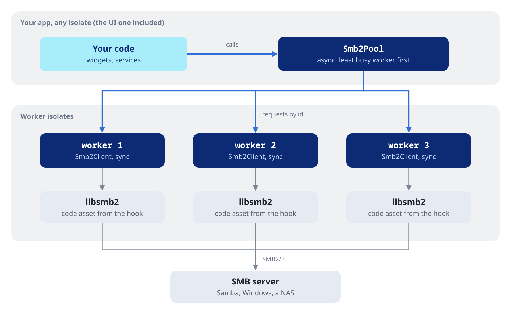
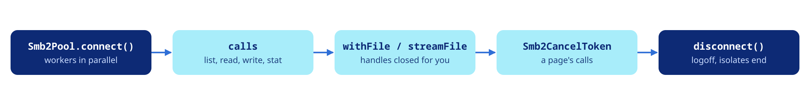

Connect a pool to a share, list the shares of a server and disconnect.

`Smb2Pool` is the entry point. It runs a few worker isolates, each with its own connection to the share and its own `Smb2Client`, the synchronous client over libsmb2. Your code calls the pool from any isolate. Each call goes to the least busy worker, and its result comes back without blocking the caller.





## Connecting a pool

```dart
final pool = await Smb2Pool.connect(
  host: 'nas.local',
  share: 'Music',
  user: 'alice',
  password: 'secret',
  workers: 4,
);
```

The workers connect in parallel. When one of them cannot, the others are closed and `connect` throws that worker's `Smb2Exception`: `auth` for wrong credentials, `notFound` for a share that does not exist, a network failure for a host that does not answer.

## Connection options

| Argument | Default | Description |
| :--- | :--- | :--- |
| `user`, `password`, `domain` | none | NTLM credentials. No user, or a null password, means an anonymous logon; `password: ''` logs on to an account without a password |
| `workers` | 4 | Isolates, each with its own connection |
| `timeout` | 30 s | Bounds every request, the connection included |
| `seal` | `false` | Require SMB3 encryption |
| `signing` | `false` | Require signed messages |
| `version` | `Smb2Version.any` | The dialect to negotiate, from `v202` to `v311` |

```dart
final secure = await Smb2Pool.connect(
  host: 'nas.local',
  share: 'Private',
  user: 'alice',
  password: 'secret',
  seal: true,
  version: Smb2Version.v311,
  timeout: const Duration(seconds: 10),
);
```

## Listing the shares of a server

`listSharesOn` needs no pool: it connects to `IPC$` from a short-lived isolate, lists the shares and disconnects.

```dart
final shares = await Smb2Pool.listSharesOn(
  host: 'nas.local',
  user: 'alice',
  password: 'secret',
);
for (final share in shares.where((s) => s.isDisk && !s.isHidden)) {
  print('${share.name}  ${share.remark}');
}
```

## Paths

Paths are relative to the share: `''` is its root, `Album/cover.jpg` a file in it. A leading slash is dropped and backslashes become slashes, so `/Album\cover.jpg` names the same file. A path with a NUL character fails with `invalidParam` before it reaches the server.

## Disconnecting

```dart
await pool.disconnect();
```

Each worker finishes the requests it has already been sent, closes its open files and logs off, and its isolate ends. A worker that does not finish within 5 seconds is killed. A reconnect in progress is aborted, and later calls fail with a `state` error.

When a connection drops while the pool is open, the pool reconnects on its own. See [Errors and cancellation](https://pub.dev/documentation/dart_smb2/latest/topics/Errors%20and%20cancellation-topic.html).
