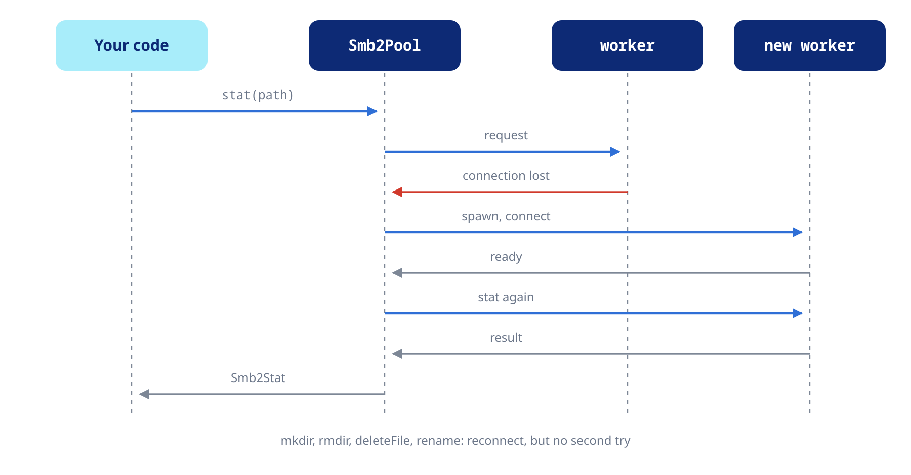

Cancel calls, branch on the type of a failure and see what the pool does when a connection drops.

## Cancellation

Every call on a connected pool takes an `Smb2CancelToken`, except `closeHandle` and `disconnect`. A cancelled call throws an `Smb2Exception` of type `cancelled` at once, also while it waits for a reconnect. A request the worker already sent finishes on the server and its result is dropped, and a file it opened is closed.

```dart
final token = Smb2CancelToken();
final download = pool.downloadToFile(
  'Album/01 - Intro.flac',
  '/tmp/intro.flac',
  cancelToken: token,
);

// The user pressed stop:
token.cancel();

try {
  await download;
} on Smb2Exception catch (e) {
  if (!e.isCancelled) rethrow;
}
```

One token cancels any number of calls, once. Make a new token for the next page, folder or download.

## Error types

Every failure is an `Smb2Exception`. Its `type` comes from the NT status the server answered with, from the errno libsmb2 reported, or from a transport failure, and reads the same on every platform.

| Type | Meaning |
| :--- | :--- |
| `connection` | The connection failed or was lost, the host name does not resolve, or the server dropped the session or a handle |
| `timeout` | The server did not answer within the timeout |
| `auth` | Wrong credentials, or the account cannot log on |
| `notFound` | The path or the share does not exist |
| `accessDenied` | No permission for the operation |
| `notADirectory`, `isADirectory` | A file where a directory was expected, or the opposite |
| `alreadyExists`, `notEmpty` | The target exists; the directory has entries |
| `inUse` | Another client holds the file open or locked, or the server is out of resources for the moment |
| `diskFull` | Out of space or over quota |
| `io`, `invalidParam`, `notSupported` | A read or write failure, a bad argument, an unsupported operation |
| `state` | Closed pool, closed handle, client not connected |
| `cancelled` | Cancelled through an `Smb2CancelToken` |
| `unknown` | Anything else |

The predicates group them the way dart_plex and dart_jellyfin do:

```dart
try {
  await pool.listDirectory('Album');
} on Smb2Exception catch (e) {
  if (e.isAuthError) {
    print('ask for the password again');
  } else if (e.isNotFound) {
    print('gone');
  } else if (e.isTransient) {
    print('try again later');
  } else if (!e.isCancelled) {
    print('${e.type.name}: ${e.message}');
  }
}
```

`isNetworkFailure` covers `connection` and `timeout`, and `isTransient` adds `inUse`. `ntStatus` and `errno` keep the raw codes.

## Reconnects



When a call fails with a network failure, the pool replaces the worker with a new connection. It does so once, however many calls saw it fail, and repeats the call when repeating cannot change the outcome: reads, listings, metadata, writes at an offset, whole-file writes, truncates and timestamps.

`mkdir`, `rmdir`, `deleteFile` and `rename` are not repeated, because the server may have done them before the connection dropped. Their error reaches you, and the next call uses the new connection.

Open handles are reopened on the new worker before their next call. While a worker cannot reconnect, the others take its calls and it keeps trying in the background. After a refused login it tries once every 5 minutes.
