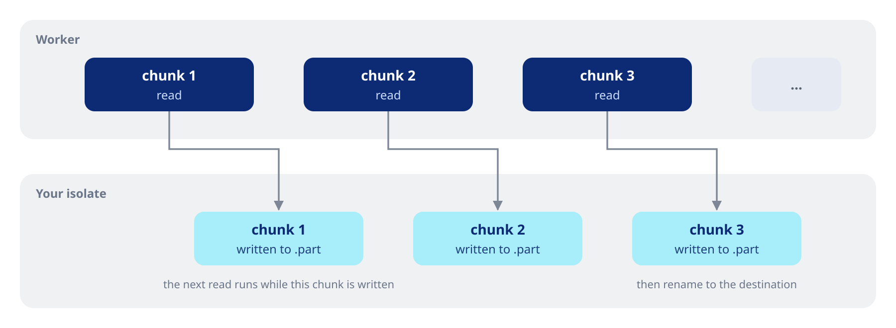

Read and write files whole, by range or through handles, and stream them to and from the share.

## Reading

### Whole files and ranges

```dart
final cover = await pool.readFile('Album/cover.jpg');
final header = await pool.readFileRange(
  'Album/01 - Intro.flac',
  length: 64 * 1024,
);
```

A range returns fewer bytes than asked only when the file ends first. Reads larger than what the server accepts in one request are split for you.

### A file open for several reads

`withFile` opens a file once, hands it to your callback and closes it on every exit path.

```dart
final tag = await pool.withFile('Album/01 - Intro.flac', (file) async {
  final head = await file.read(length: 10);
  final tail = await file.read(offset: file.size - 128, length: 128);
  return (head, tail);
});
```

Pass `knownSize` when a listing already gave the size: the open then skips the size request.

### Handles

For files that stay open across calls, open a handle and close it yourself.

```dart
final (handle, size) = await pool.openFileWithSize('Album/01 - Intro.flac');
try {
  final first = await pool.readFromHandle(handle, length: 4096);
  final last = await pool.readFromHandle(handle, offset: size - 4096, length: 4096);
} finally {
  await pool.closeHandle(handle);
}
```

A handle stays on the worker that opened it. If that worker reconnects, the handle is opened again before its next call. Closing a handle twice does nothing. Any other use of a closed handle throws a `state` error. A handle dropped without being closed is closed when it is garbage collected.

## Streaming and downloads



### Streaming a file

```dart
final stream = pool.streamFile(
  'Album/01 - Intro.flac',
  onProgress: (received, total) => print('$received / $total'),
);
await for (final chunk in stream) {
  print('${chunk.length} bytes');
}
```

The stream keeps one file handle open and reads the next chunk while you handle the current one. It waits while its listener is paused, so at most two chunks (4 MiB each by default, see `chunkSize`) are in memory. Cancelling the subscription or the token closes the handle.

### Downloading to disk

```dart
final written = await pool.downloadToFile(
  'Album/01 - Intro.flac',
  '/storage/music/01 - Intro.flac',
  onProgress: (received, total) => print('${received * 100 ~/ total}%'),
);
```

The data goes to a temporary file next to the destination as it arrives, at the pace the disk takes it, and is renamed to the destination only once complete. A failure or a cancellation removes the temporary file and leaves the destination as it was.

## Writing

### Whole files and ranges

```dart
await pool.writeFile('Notes/todo.txt', utf8.encode('buy milk\n'));
await pool.writeFileRange('Notes/todo.txt', utf8.encode('eggs\n'), offset: 9);
```

`writeFile` replaces the file, creating it if needed. `writeFileRange` writes at an offset and leaves the rest of the file as it is. The data is copied into a native buffer in the calling isolate: for large writes from the UI isolate, prefer `streamWrite`.

### Streaming a write

```dart
final upload = File('/storage/music/01 - Intro.flac')
    .openRead()
    .map(Uint8List.fromList);
await pool.streamWrite('Backup/01 - Intro.flac', upload);
```

The chunks go through one handle, each at its own offset, so only one is in memory at a time and a reconnect repeats just the chunk that failed.

### Write handles

```dart
final out = await pool.openFileWrite('Backup/log.bin', truncate: true);
try {
  await pool.writeToHandle(out, Uint8List.fromList([1, 2, 3]));
  await pool.writeToHandle(out, Uint8List.fromList([4]), offset: 3);
  await pool.fsyncHandle(out);
} finally {
  await pool.closeHandle(out);
}
```

`ftruncateHandle` cuts or extends the file of a handle.
